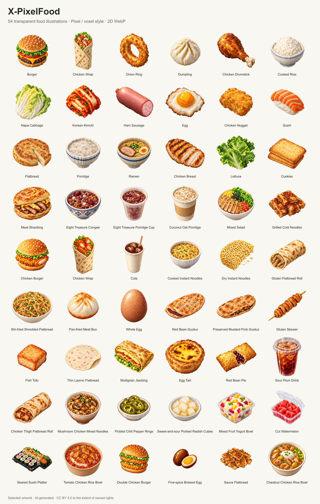

# X-PixelFood 素材

[English](README.md) · [简体中文](README.zh-CN.md) · [繁體中文](README.zh-TW.md)
· [日本語](README.ja.md) · [한국어](README.ko.md) · [Español](README.es.md)

54 件入选 WebP + PNG 素材。catalog.json 提供稳定
ID、来源／输出哈希与三语名称。可使用 assets/webp/<id>.webp 或无损解码的
assets/png/<id>.png；这是平面插图，非可编辑 3D 模型。

## 使用

直接使用 `assets/webp/<id>.webp`，另附
`losslessly decoded assets/png/<id>.png`。catalog.json 提供稳定 ID
与来源／输出哈希；文件名保持稳定。使用素材不需要服务器、账号或构建工具。
WebP／PNG 均保留透明背景；PNG
是无损解码的交付副本，不是私人原稿。名称表示绘制主题，不证明配料或营养。

## 可选本地工具

随附的 Deno 工具只处理已选的 54 张图，不代表完整私人图库。运行 `deno task build`
和 `deno task verify` 重建并校验选集；`deno task preview` 写入
`Local/gallery.html`，`deno task demo` 在回环地址 `127.0.0.1:18220` 提供页面。

安装 `rsvg-convert` 与 `dwebp` 后，可运行 `deno task preview:png rsvg` 生成本地
PNG，输出位于
`Local/preview-export/`，不会替换已审查封包预览；更新正式封包须另行审查并重封收据。macOS
默认使用 Ego；`deno task setup` 可能通过 Homebrew
安装缺少的工具。本候选的浏览器界面尚未验证。

运行 `deno task test` 执行本地回归测试。

## 许可与署名

请标注 X-PixelFood 与所附来源／出处、链接
https://creativecommons.org/licenses/by/4.0/ 并说明修改。CC BY 4.0
仅涵盖可授权的自有权利，不授予商标或第三方权利。这些插图为委托 AI
生成；此事实不证明版权成立或第三方元素权利。

文档标志：codingEzio，[CC BY 4.0](https://creativecommons.org/licenses/by/4.0/)
([ARTWORK-LICENSE.md](ARTWORK-LICENSE.md))；请注明修改。此独立授权仅涵盖
`docs/icon.svg`，不改变已选定的收藏作品范围。

## 来源范围

本地候选包排除来源未明素材、私人原文件、未选入的工具源码及原 Git 历史。参见
LICENSE-SCOPE.json 与
candidate-receipt.json。此次仅核对来源、容器元数据与可见内容，不保证版权成立或全面法律审查通过；尚未授权发布。

## 私人图库

完整数据放在仓库外的私人目录，包含
`foods.json`、`provenance.json`、`LICENSE-SCOPE.json` 和
`assets/webp/`。公开选集的数据与哈希必须一致；原稿和敏感来源数据另行保存。完整
`foods.json` 可供需要全部 ID 的程序使用。

运行 `deno task private:demo /私人数据的绝对路径`，在本机打开
`http://127.0.0.1:18221/`；第二个参数可指定端口。此图库只读，仅通过本机回环地址提供嵌入图片的页面。公开构建不读取私人目录；不要将私人素材或完整预览加入
Git 或公开导出。公开素材更新后，须同步核对私人记录。

### 维护私人素材

原始 PNG 与私人来源收据分别保存在
`ROOT/originals/`、`ROOT/receipts/`，图库和构建不会读取，也不会公开导出；迁移时保留已有原稿。新增
WebP 到 `ROOT/assets/webp/`，同步更新
`ROOT/foods.json`、`ROOT/provenance.json`、`ROOT/LICENSE-SCOPE.json`，并保持公开项目一致。另行检查素材与来源证据。

运行 `deno task private:build /绝对ROOT [ego|rsvg]`：macOS 默认
Ego，其他系统默认 librsvg；`rsvg` 需要 `rsvg-convert` 和 `dwebp`。输出到
`ROOT/builds/BUILD_ID/`，包含 catalog、SVG、PNG 和收据；catalog 素材路径相对于
ROOT。运行
`deno task private:verify /绝对ROOT BUILD_ID`，并检查预览。重跑会验证并复用相同输出；损坏或不完整的输出不会被覆盖，失败暂存保留供检查。完整图库产物保持私人。Godspeed
catalog CLI 请明确指向 `ROOT/foods.json`；其 export 可能修改此文件。
